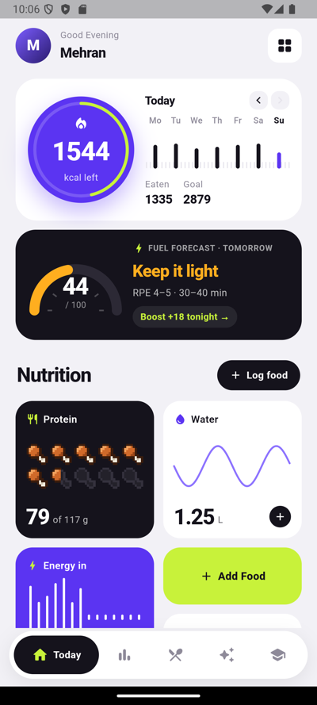
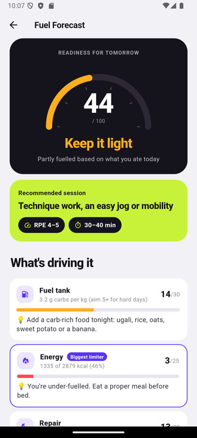
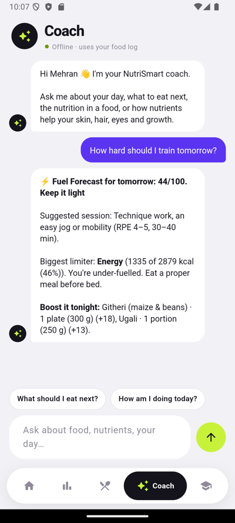
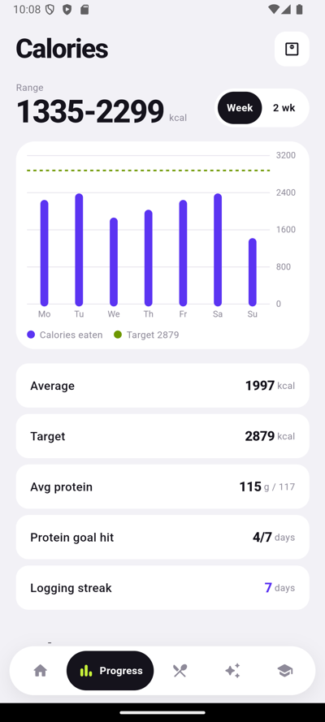
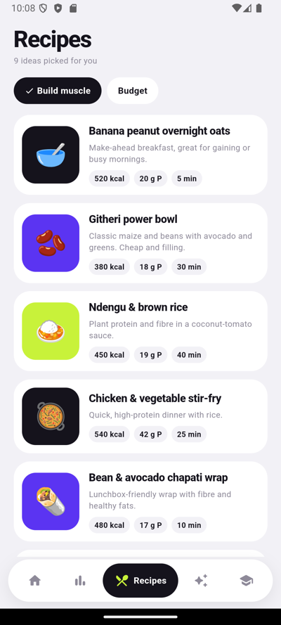
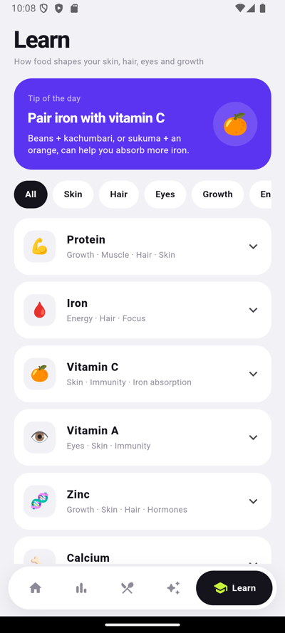

# NutriSmart

An Android nutrition tracker built around Kenyan food. It sets personal targets from your body and goals, logs meals from a local food list, USDA or a barcode, and predicts how hard you can train tomorrow based on what you ate today.

<p>
  
  
  
</p>

## Features

- **Personal targets.** Calories and protein are worked out with the Mifflin-St Jeor equation from age, sex, height, weight, activity level and goal. Under-18s get a smaller deficit because they are still growing.
- **Fuel Forecast.** Scores tomorrow's training readiness out of 100 from carbs, calories, protein, water, and iron + vitamin C. It suggests a session and effort level, names the biggest limiter, and lists foods you could still eat tonight with how many points each would add.
- **Food logging.** 67 built-in local foods (ugali, githeri, sukuma wiki, chapati, omena…), USDA FoodData Central search with an Open Food Facts fallback, and a barcode scanner.
- **Offline coach.** A chat assistant that answers questions from your own food log, such as "what should I eat next?" or "how hard should I train tomorrow?". It runs entirely on the phone.
- **Protein meter.** Protein shows as a row of pixel-art drumsticks that fill in halves.
- **Progress, recipes and a nutrient guide.** Weekly charts, 13 local recipes, and short explanations of what each nutrient does for skin, hair, eyes and growth.
- **Reminders.** Optional daily meal and water notifications.
- **Strava.** Coming soon.

<p>
  
  
  
</p>

## How the Fuel Forecast works

| Factor | What it looks at | Points |
|---|---|---|
| Fuel tank | Carbs per kg of body weight (today, plus some of yesterday) | 30 |
| Energy | Calories eaten vs your target | 25 |
| Repair | Protein per kg | 20 |
| Hydration | Water vs your target | 15 |
| Micronutrients | Iron and vitamin C | 10 |

Too much sugar or salt takes up to 10 points off. A score of 80+ means *Go hard*, 60+ *Train normally*, 40+ *Keep it light*, and below 40 *Recover*. It only uses food data, so it can't account for sleep, stress or illness, and it is a guide rather than medical advice.

The code is in [`lib/services/fuel_forecast.dart`](lib/services/fuel_forecast.dart).

## Project layout

```
lib/
  data/       local foods, recipes, nutrient guide
  models/     food, nutrients, log entries, user profile
  services/   target calculator, Fuel Forecast, food APIs, offline coach, notifications
  state/      app state, saved on the device
  screens/    Today, Forecast, Progress, Recipes, Coach, Learn, Add food, Settings…
  widgets/    charts, cards and the drumstick meter
```

## Running it

Requires Flutter 3.x (Dart 3).

```
flutter pub get
flutter run
```

Food search uses the public USDA `DEMO_KEY`, which has a low rate limit. For heavier use, get a free key at https://fdc.nal.usda.gov/api-key-signup and set `usdaApiKey` in `lib/services/food_api.dart`.

## Built with

Flutter · Dart · USDA FoodData Central · Open Food Facts · mobile_scanner · flutter_local_notifications · shared_preferences
